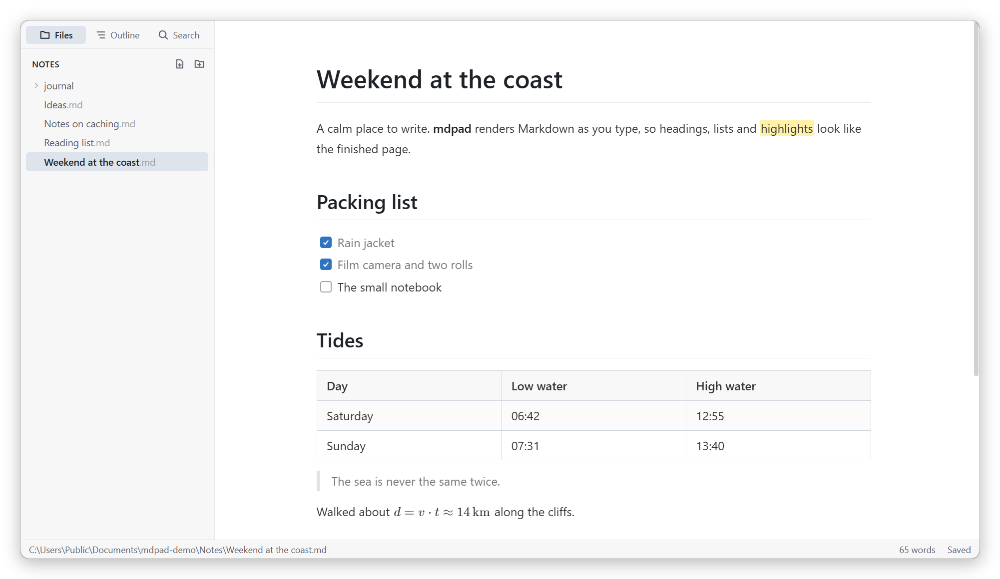
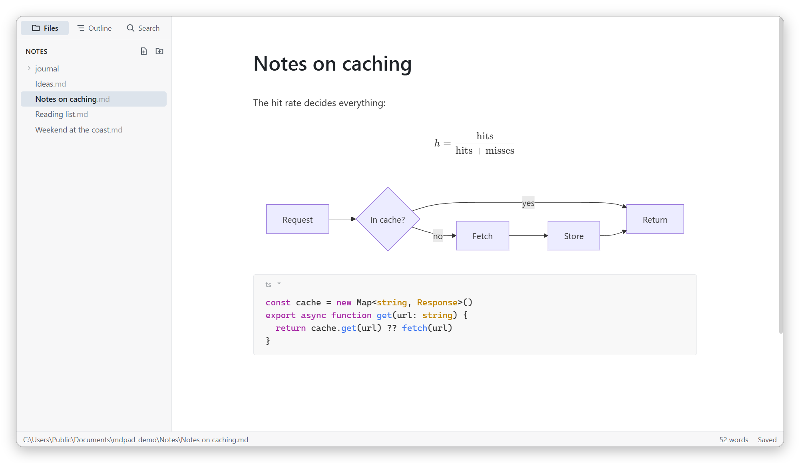

<div align="center">


# mdpad

**A calm, Typora-style Markdown editor for Windows.**<br />
What you type is what you see, and your files stay exactly as you wrote them.

<a href="#install"></a>


[Features](#features) · [Install](#install) · [Shortcuts](#keyboard-shortcuts) · [Development](#development)

</div>

<br />

<picture>
  <source media="(prefers-color-scheme: dark)" srcset="docs/screenshots/hero-dark.png" />
  
</picture>

<br />

## Why mdpad

<table>
  <tr>
    <td width="33%" valign="top">
      <h4>Write on the page</h4>
      Markdown renders as you type. Headings, lists, tables and math look finished, and the syntax shows only around your caret.
    </td>
    <td width="33%" valign="top">
      <h4>Files stay yours</h4>
      An untouched file is never rewritten. Line endings, BOM and front matter survive, and every save is atomic.
    </td>
    <td width="33%" valign="top">
      <h4>Quiet by default</h4>
      No toolbar and no clutter. One column of text, a sidebar when you want it, and focus and typewriter modes for long sessions.
    </td>
  </tr>
</table>

## Features

**Writing**

- Live WYSIWYG editing built on Milkdown and ProseMirror, with the Markdown syntax revealed around the caret
- GitHub Flavored Markdown: tables, task lists, strikethrough, autolinks and footnotes
- Code blocks with syntax highlighting for dozens of languages
- `==Highlights==`, `$inline$` and `$$block$$` math (KaTeX) and Mermaid diagrams
- Paste or drop images. They're saved to a `<name>.assets` folder beside the document, Typora-style
- Source code mode (<kbd>Ctrl</kbd> <kbd>/</kbd>) when you want the raw Markdown

**Workspace**

- Open a folder to get a live file tree: create, rename, and delete to the Recycle Bin
- Quick Open (<kbd>Ctrl</kbd> <kbd>P</kbd>), search across the folder and a document outline
- Find and replace inside the document
- Light and dark themes, or follow Windows. Your own CSS can restyle everything
- Fonts, text size, line width and every shortcut are adjustable in Preferences

**Safety**

- Autosave, plus crash recovery for unsaved drafts
- Changes made by other programs are picked up, with a prompt if you have unsaved edits
- Export to HTML or PDF
- Opens `.md` files from Explorer and remembers recent files and folders

<br />

<picture>
  <source media="(prefers-color-scheme: dark)" srcset="docs/screenshots/extras-dark.png" />
  
</picture>

## Install

mdpad isn't published as a download yet. Build the installer from source:

```bash
git clone https://github.com/Lecberg/mdpad.git
cd mdpad
npm install
npm run build:win
```

Then run `dist/mdpad-1.0.0-setup.exe`. It adds a Start menu entry and a desktop shortcut, and offers mdpad as an editor for `.md` files.

## Keyboard shortcuts

<details>
<summary>Show all shortcuts</summary>
<br />

| Action                             | Shortcut                                                                                                                                      |
| ---------------------------------- | --------------------------------------------------------------------------------------------------------------------------------------------- |
| Quick Open                         | <kbd>Ctrl</kbd> <kbd>P</kbd>                                                                                                                  |
| Save / Save As                     | <kbd>Ctrl</kbd> <kbd>S</kbd> / <kbd>Ctrl</kbd> <kbd>Shift</kbd> <kbd>S</kbd>                                                                  |
| Find / Replace                     | <kbd>Ctrl</kbd> <kbd>F</kbd> / <kbd>Ctrl</kbd> <kbd>H</kbd>                                                                                   |
| Heading 1–6 / Paragraph            | <kbd>Ctrl</kbd> <kbd>1</kbd>–<kbd>6</kbd> / <kbd>Ctrl</kbd> <kbd>0</kbd>                                                                      |
| Bold / Italic / Link               | <kbd>Ctrl</kbd> <kbd>B</kbd> / <kbd>Ctrl</kbd> <kbd>I</kbd> / <kbd>Ctrl</kbd> <kbd>K</kbd>                                                    |
| Inline code                        | <kbd>Ctrl</kbd> <kbd>Shift</kbd> <kbd>`</kbd>                                                                                                 |
| Highlight                          | <kbd>Ctrl</kbd> <kbd>Shift</kbd> <kbd>H</kbd>                                                                                                 |
| Strikethrough                      | <kbd>Alt</kbd> <kbd>Shift</kbd> <kbd>5</kbd>                                                                                                  |
| Quote                              | <kbd>Ctrl</kbd> <kbd>Shift</kbd> <kbd>Q</kbd>                                                                                                 |
| Ordered / Unordered list           | <kbd>Ctrl</kbd> <kbd>Shift</kbd> <kbd>[</kbd> / <kbd>Ctrl</kbd> <kbd>Shift</kbd> <kbd>]</kbd>                                                 |
| Code block / Math block / Table    | <kbd>Ctrl</kbd> <kbd>Shift</kbd> <kbd>K</kbd> / <kbd>Ctrl</kbd> <kbd>Shift</kbd> <kbd>M</kbd> / <kbd>Ctrl</kbd> <kbd>T</kbd>                  |
| Source code mode                   | <kbd>Ctrl</kbd> <kbd>/</kbd>                                                                                                                  |
| Focus mode / Typewriter mode       | <kbd>F8</kbd> / <kbd>F9</kbd>                                                                                                                 |
| Toggle sidebar                     | <kbd>Ctrl</kbd> <kbd>Shift</kbd> <kbd>L</kbd>                                                                                                 |
| Outline / Files / Search in folder | <kbd>Ctrl</kbd> <kbd>Shift</kbd> <kbd>1</kbd> / <kbd>Ctrl</kbd> <kbd>Shift</kbd> <kbd>3</kbd> / <kbd>Ctrl</kbd> <kbd>Shift</kbd> <kbd>F</kbd> |
| Preferences                        | <kbd>Ctrl</kbd> <kbd>,</kbd>                                                                                                                  |

Any of these can be rebound in Preferences.

</details>

## Development

Requires Node.js 22 or later.

| Command             | What it does                                   |
| ------------------- | ---------------------------------------------- |
| `npm run dev`       | Start the app with hot reload                  |
| `npm test`          | Unit tests (Vitest)                            |
| `npm run test:e2e`  | Build, then drive the real app with Playwright |
| `npm run typecheck` | Type-check main, renderer and tests            |
| `npm run lint`      | ESLint                                         |
| `npm run icons`     | Regenerate the app icons from `build/icon.svg` |
| `npm run build:win` | Build the Windows installer into `dist/`       |

<details>
<summary>Project layout</summary>
<br />

```
src/main          Electron main process: windows, menus, file IO, export
src/preload       Sandboxed bridge exposing window.api
src/shared        Types and command ids shared across processes
src/renderer/src  React UI and the editor
tests/            Vitest suites, Playwright e2e tests and sample notes
docs/PLAN.md      Roadmap and design notes
```

</details>

## Built with

[Electron](https://www.electronjs.org/) ·
[Milkdown](https://milkdown.dev/) ·
[ProseMirror](https://prosemirror.net/) ·
[CodeMirror](https://codemirror.net/) ·
[KaTeX](https://katex.org/) ·
[Mermaid](https://mermaid.js.org/) ·
[React](https://react.dev/)

Inspired by [Typora](https://typora.io/).

<br />

<div align="center">
<sub>Made for writing, not for fiddling.</sub>
</div>
